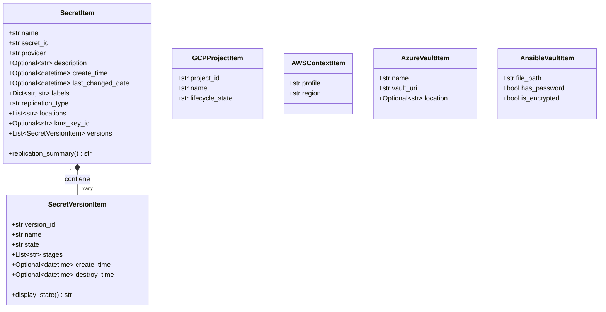

# Modelos de Datos del Dominio

Gossip implementa dataclasses en Python puro en `src.models` actuando como una **Capa Anti-Corrupción (ACL)**. En lugar de exponer a la capa de presentación objetos directos de los SDK de cada nube (`google.cloud.secretmanager_v1.Secret`, diccionarios de `boto3`, objetos de Azure `KeyVaultSecret`, o estructuras YAML directas), todos los clientes traducen las respuestas a estos modelos tipados y estandarizados.

## Arquitectura y Relaciones

## Resumen de Modelos Principales

| Modelo | Propósito | Utilizado Por |
| :--- | :--- | :--- |
| `SecretItem` | Metadatos generales del secreto, etiquetas, replicación y versiones hijas. | `MainWindow`, `SecretDialog`, todos los proveedores |
| `SecretVersionItem` | Estado de la versión, etiquetas de ciclo de vida y estado traducido. | Tabla de versiones de `MainWindow`, diálogos de versiones |
| `GCPProjectItem` | Identificador de proyecto GCP y nombre legible. | Selector de proyecto, `GCPSecretClient` |
| `AWSContextItem` | Perfil de AWS CLI activo y región de destino. | Diálogo de contexto AWS, `AWSSecretClient` |
| `AzureVaultItem` | URI del Vault de Azure y región del recurso. | Selector de Vaults, `AzureSecretClient` |
| `AnsibleVaultItem` | Ruta del archivo, estado de cifrado y caché de contraseña. | Diálogo de desbloqueo, `AnsibleVaultClient` |

---

## Especificación API (`src.models`)

::: src.models
    options:
      show_root_heading: true
      show_source: true
      members_order: source
