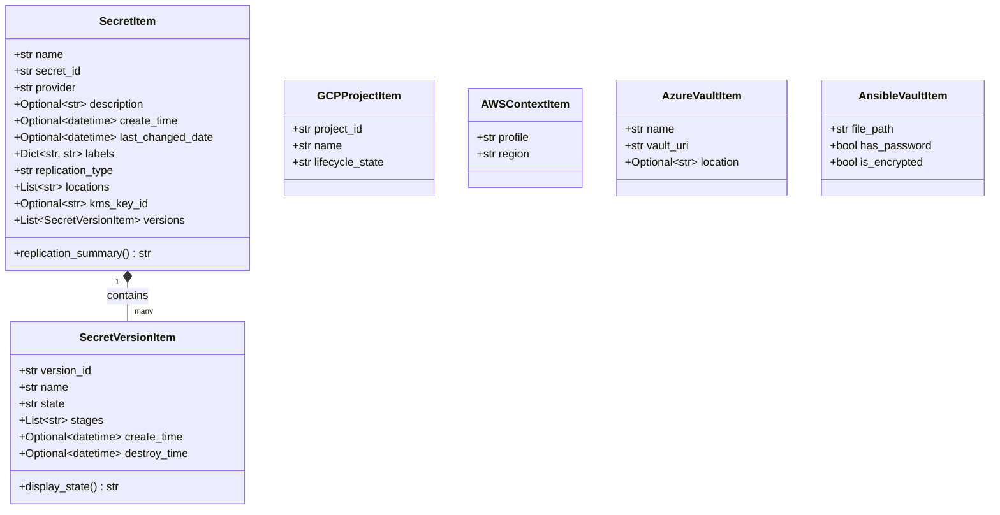

# Domain Data Models

Gossip uses pure-Python dataclasses located in `src.models` as an **Anti-Corruption Layer (ACL)**. Instead of exposing cloud-specific SDK response objects (`google.cloud.secretmanager_v1.Secret`, `boto3` dicts, Azure `KeyVaultSecret`, or raw YAML maps) to the presentation layer, all providers map data directly into these normalized models.

## Architecture & Relationships

## Core Models Overview

| Model | Purpose | Consumed By |
| :--- | :--- | :--- |
| `SecretItem` | High-level secret metadata, labels, replication, and child versions. | `MainWindow`, `SecretDialog`, all providers |
| `SecretVersionItem` | Secret version state, stages, lifecycle timestamps, and localized display state. | `MainWindow` versions table, add/destroy dialogs |
| `GCPProjectItem` | Google Cloud project identifier and display name. | Project selection dialog, `GCPSecretClient` |
| `AWSContextItem` | Active AWS CLI profile name and target region. | Context dialog, `AWSSecretClient` |
| `AzureVaultItem` | Azure Key Vault URI and resource location. | Vault selector dialog, `AzureSecretClient` |
| `AnsibleVaultItem` | File path, encryption state, and password cache indicator for local vaults. | Ansible file/unlock dialog, `AnsibleVaultClient` |

---

## API Specification (`src.models`)

::: src.models
    options:
      show_root_heading: true
      show_source: true
      members_order: source
