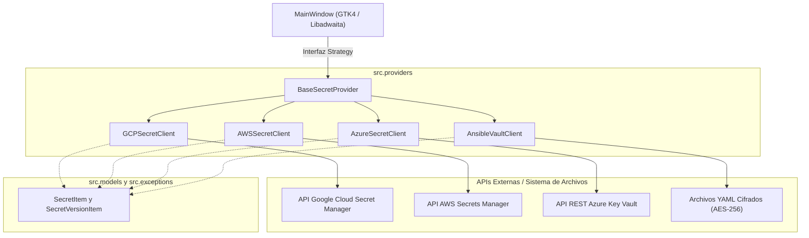
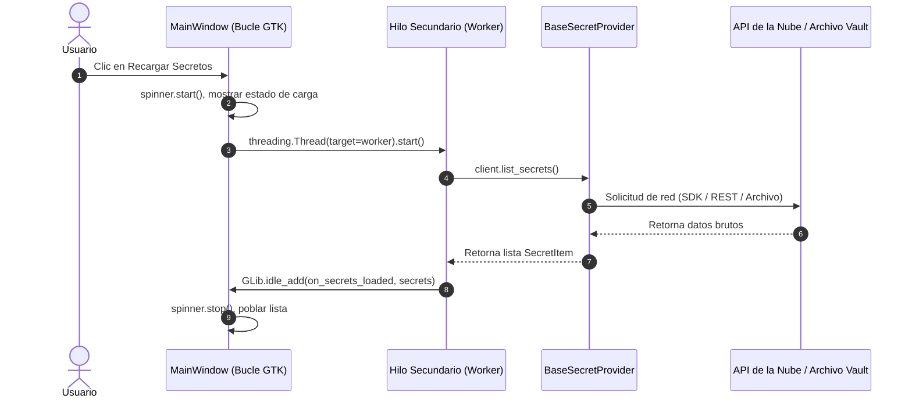

# Arquitectura del Sistema y Patrones de Diseño

Gossip está diseñado bajo los principios de **Clean Architecture** y los **Patrones de Diseño GoF**, aislando las abstracciones del dominio frente a SDKs externos y ciclos de vida de widgets de GTK4.

---

## 1. Patrón Estrategia (`src/providers/`)

El patrón primordial en Gossip es el **Patrón Estrategia (Strategy Pattern)**. La ventana principal (`MainWindow`) no conoce ni acopla detalles técnicos de ningún proveedor específico; únicamente mantiene una referencia al objeto activo de tipo `BaseSecretProvider`.

### Delegación Polimórfica
Al cambiar de proveedor en el desplegable de la barra de título, `MainWindow` conmuta la estrategia activa y delega de forma polimórfica:
- `self.active_provider.context_subtitle`: Subtítulo mostrado en el HeaderBar (ej. `Proyecto GCP: prod-cluster`, `AWS: default (us-east-1)`).
- `self.active_provider.icon_name`: Icono simbólico de la acción de contexto.
- `self.active_provider.loading_message`: Mensaje de carga localizado.
- `self.active_provider.open_context_dialog()`: Abre el modal de configuración específico del proveedor.

---

## 2. Modelo de Concurrencia Asíncrona

GTK4 procesa eventos en un único hilo. Cualquier bloqueo de red o I/O síncrono congelaría la interfaz gráfica. Gossip implementa una política estricta de ejecución asíncrona mediante hilos secundarios daemon de Python (`threading.Thread`) y sincronización con el bucle de GTK mediante `GLib.idle_add()`.

