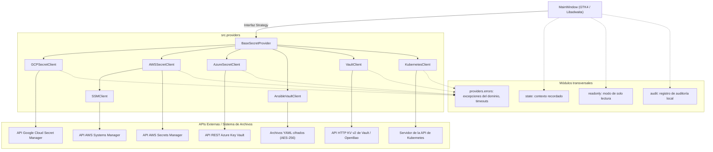
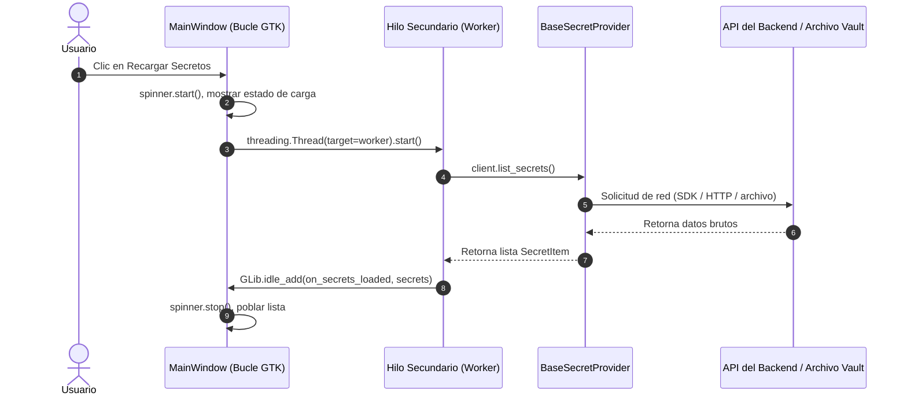

# Arquitectura del Sistema y Patrones de Diseño

Gossip está diseñado bajo los principios de **Clean Architecture** y los **Patrones de Diseño GoF**, aislando las abstracciones del dominio frente a SDKs externos y ciclos de vida de widgets de GTK4.



---

## 1. Patrón Estrategia (`src/providers/`)

El patrón primordial es el **Patrón Estrategia (Strategy Pattern)**. La ventana principal (`MainWindow`) no sabe qué backend está seleccionado; únicamente mantiene una referencia al `BaseSecretProvider` activo.

### Delegación Polimórfica
Al cambiar de proveedor en la barra de cabecera, `MainWindow` conmuta su `self.active_provider` y delega:
- `context_subtitle`: el subtítulo (ej. `Proyecto GCP: prod-cluster`, `AWS: default (us-east-1)`, `Kubernetes: staging / apps`).
- `icon_name`, `loading_message`, `empty_message`, `error_message`: el icono y los mensajes localizados del proveedor.
- `open_context_dialog()`: abre el modal específico del proveedor.
- `supports_version_toggling` / `supports_version_destroy`: qué acciones sobre versiones ofrece la interfaz.
- `lock()`: olvidar el material secreto en memoria cuando salta el bloqueo por inactividad.
- `saved_context()` / `restore_context()`: las selecciones no sensibles que se recuerdan entre ejecuciones.

Añadir un proveedor implica implementar `BaseSecretProvider`, añadir un `ProviderSpec` a `src/registry.py` (su cliente, los ajustes del constructor y sus opciones de línea de comandos) y su diálogo de contexto. La línea de comandos, `GossipApplication` y `MainWindow` construyen sus clientes desde ese registro, así que ninguno cambia; los clientes se cargan por nombre al construirlos, de modo que `--help` y el autotest no importan todos los SDK de nube. `SSMClient` reutiliza el perfil, la región y el diálogo de AWS extendiendo `AWSSecretClient`.

---

## 2. Modelo de Concurrencia Asíncrona

GTK4 procesa eventos en un único hilo; la latencia de red o el I/O síncrono en el hilo principal congelaría la interfaz. Gossip ejecuta cada llamada a un proveedor en hilos `threading.Thread(daemon=True)` y devuelve los resultados al bucle de GTK con `GLib.idle_add()`. Las respuestas llevan un identificador de petición, de modo que una respuesta lenta de una selección anterior se ignora en lugar de mostrar un valor bajo el secreto equivocado.



---

## 3. Gestión de Errores

Cada proveedor convierte los fallos de SDK y HTTP en la jerarquía de [`src.exceptions`](api/exceptions.md) mediante un único ayudante, `src.providers.errors.provider_error()`:

| Tipo | Excepción del dominio | También es la integrada |
|---|---|---|
| denegado | `PermissionDeniedError` | `PermissionError` |
| no encontrado | `ResourceNotFoundError` | `FileNotFoundError` |
| conflicto | `SecretConflictError` | `ValueError` |
| otro | `ProviderOperationError` | `RuntimeError` |

`guard_network()` envuelve las operaciones de los proveedores para que los fallos de conexión y los tiempos agotados (AWS y Azure usan 10 s para conectar, 30 s para leer y dos reintentos) lleguen como un único mensaje claro.

---

## 4. Módulos Transversales

| Módulo | Responsabilidad |
|---|---|
| `src/state.py` | Recuerda el último proveedor y contexto, los cinco contextos más recientes y las preferencias de interfaz en un `state.json` privado, descartando todo lo que parezca una credencial |
| `src/readonly.py` | Interruptor de solo lectura, el bloqueo de `--read-only` y la guarda `@blocks_writes` para las acciones de la ventana |
| `src/audit.py` | Registro de auditoría opcional en JSON por líneas (solo nombres, nunca valores), archivo privado, rotación a 5 MB |
| `src/clipboard.py` | Contenido del portapapeles marcado como sensible para los gestores de portapapeles |
| `src/passwords.py` | Generador de contraseñas aleatorias (`secrets`) |
| `src/tree.py` | Convierte los nombres con `/` en las carpetas y filas de la barra lateral |
| `src/age.py` | Cuánto hace que cambió un secreto (la marca de antigüedad) |
| `src/payload_view.py`, `src/labels.py` | Tabla de claves de un valor JSON; lectura de etiquetas `clave=valor` |
| `src/diagnostics.py`, `src/log.py` | Informe de diagnóstico redactado y el anillo de registro en memoria |
| `src/transfer.py` | Exportación e importación de secretos entre proveedores (JSON / YAML) |
| `src/search.py`, `src/diffing.py` | Lenguaje de consulta de la barra lateral y diff de versiones |
| `src/selftest.py` | `gossip --self-test`: verifica cada dependencia incluida y un ciclo real de cifrado |
| `src/log.py` | Diagnóstico opcional (`--debug`) |

---

## 5. Estructura de Paquetes

```
src/
├── models.py       # Clases de datos del dominio (sin dependencias de GUI ni de red)
├── exceptions.py   # Excepciones del dominio (jerarquía ProviderError)
├── i18n.py         # Runtime de internacionalización y compilador PO a MO
├── main.py         # Punto de entrada y analizador de la CLI
├── state.py, readonly.py, audit.py, transfer.py, search.py, diffing.py, selftest.py, log.py
├── providers/      # Estrategias de gestión de secretos
│   ├── base.py, errors.py
│   ├── gcp/, aws/, ssm/, azure/, ansible/, vault/, kubernetes/
└── ui/             # Capa de presentación (Libadwaita / GTK4)
    ├── app.py      # Adw.Application, CSS global, restauración del contexto recordado
    ├── window.py   # MainWindow ensamblada con mixins
    ├── windows/    # state (sin GTK), base (contrato compartido), builder, nav, sidebar, detail,
    │               # versions, payload, compare, actions, transfer, shortcuts, bloqueo por inactividad
    └── dialogs/    # Diálogos modales: contextos, crear, confirmar, comparar, transferir, acerca de
```

---

## 6. Estado de la ventana

`MainWindow` se ensambla con mixins que heredan todos de `windows/base.py`, que declara una sola vez los widgets y los métodos que se llaman entre sí. Lo que la ventana *recuerda* (proveedor activo, secretos, secreto seleccionado, versiones, el valor revelado) vive en `windows/state.py`, un objeto simple sin GTK. Contiene las reglas que protegen los secretos: un valor solo permanece en memoria mientras está revelado, seleccionar otro secreto o proveedor lo olvida, y una respuesta a una petición de valor se ignora si otra petición posterior, otro secreto u otro proveedor la ha reemplazado. Como no necesita pantalla, esas reglas tienen sus propias pruebas unitarias.

Dos pequeños ayudantes mantienen uniforme el código de la ventana: `DialogFactory` (`ui/dialogs/factory.py`) es el único sitio que abre diálogos, de modo que una prueba u otro front end cambia un atributo en lugar de parchear módulos, y `run_in_background` (`ui/background.py`) ejecuta una llamada a un proveedor fuera del hilo de GTK y responde en el bucle principal, convirtiendo los fallos en un aviso de error salvo que quien llama los gestione. Del lado de los proveedores, `client_failure` y `status_failure` (`providers/errors.py`) traducen los fallos de botocore y HTTP a las excepciones del dominio para AWS, Parameter Store y Azure.
