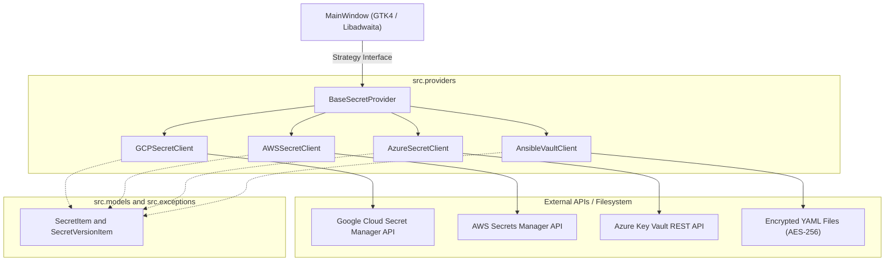
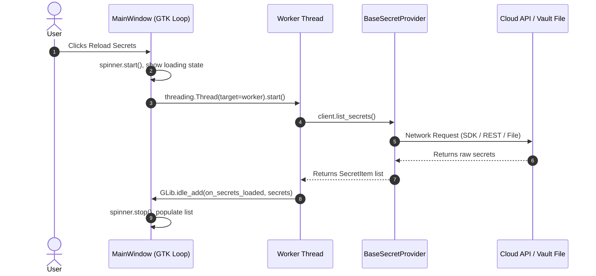

# System Architecture & Design Patterns

Gossip is engineered around **Clean Architecture** and classic **GoF Design Patterns**, isolating domain abstractions from third-party cloud SDKs and GTK4 widget lifecycles.



---

## 1. Strategy Pattern (`src/providers/`)

The primary design pattern used in Gossip is the **Strategy Pattern**. The application window (`MainWindow`) does not know or care which cloud provider is currently selected; it simply holds a reference to an active instance of `BaseSecretProvider`.

### Polymorphic Delegation
When the user switches providers in the HeaderBar dropdown, `MainWindow` switches its `self.active_provider` strategy and automatically delegates:
- `self.active_provider.context_subtitle`: Subtitle displayed in HeaderBar (e.g. `GCP Project: prod-cluster`, `AWS: default (us-east-1)`).
- `self.active_provider.icon_name`: Provider-specific action icon.
- `self.active_provider.loading_message`: Localized querying message.
- `self.active_provider.open_context_dialog()`: Triggers the provider-specific modal dialog.

---

## 2. Asynchronous Threading Model

GTK4 is single-threaded; any network latency or synchronous I/O executed on the main thread would freeze the UI. Gossip strictly implements non-blocking asynchronous execution using Python's `threading.Thread(daemon=True)` coupled with `GLib.idle_add()`.



---

## 3. Package Layout & Layering

```
src/
├── models.py       # Pure domain data classes (no GUI or network dependencies)
├── exceptions.py   # Normalized domain exceptions (ProviderError hierarchy)
├── i18n.py         # Internationalization runtime & automated PO-to-MO compiler
├── main.py         # Entrypoint & CLI parameter parser
├── providers/      # Encapsulated secret management strategies
└── ui/             # Presentation layer (Libadwaita / GTK4)
    ├── app.py      # Adw.Application entrypoint & global CSS
    ├── window.py   # Main window layout, sidebar, viewer & state
    └── dialogs/    # Decoupled modal dialogs for settings & actions
```
