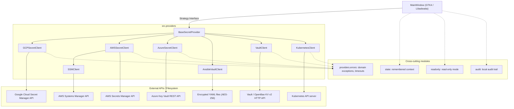
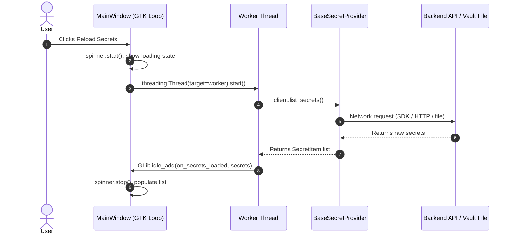

# System Architecture & Design Patterns

Gossip is engineered around **Clean Architecture** and classic **GoF Design Patterns**, isolating domain abstractions from third-party SDKs and GTK4 widget lifecycles.



---

## 1. Strategy Pattern (`src/providers/`)

The primary design pattern is the **Strategy Pattern**. The application window (`MainWindow`) does not know which backend is selected; it only holds a reference to an active `BaseSecretProvider`.

### Polymorphic Delegation
When the user switches providers in the header bar, `MainWindow` switches its `self.active_provider` and delegates:
- `context_subtitle`: the subtitle (e.g. `GCP Project: prod-cluster`, `AWS: default (us-east-1)`, `Kubernetes: staging / apps`).
- `icon_name`, `loading_message`, `empty_message`, `error_message`: the provider's icon and localized messages.
- `open_context_dialog()`: opens the provider-specific modal.
- `supports_version_toggling` / `supports_version_destroy`: which version actions the interface offers.
- `lock()`: forget in-memory secret material when the inactivity lock fires.
- `saved_context()` / `restore_context()`: the non-sensitive selections remembered between runs.

Adding a provider means implementing `BaseSecretProvider`, adding one `ProviderSpec` to `src/registry.py` (its client, constructor settings and command-line options) and its context dialog. The command line, `GossipApplication` and `MainWindow` all build their clients from that registry, so none of them changes; clients are loaded by name when built, so `--help` and the self-test do not import every cloud SDK. `SSMClient` reuses the AWS profile, region and dialog by extending `AWSSecretClient`.

---

## 2. Asynchronous Threading Model

GTK4 is single-threaded; network latency or synchronous I/O on the main thread would freeze the UI. Gossip runs every provider call in `threading.Thread(daemon=True)` workers and returns results to the GTK loop with `GLib.idle_add()`. Replies carry a request id, so a slow answer for a previous selection is ignored instead of showing a value under the wrong secret.



---

## 3. Error Handling

Every provider turns SDK and HTTP failures into the hierarchy of [`src.exceptions`](api/exceptions.md) through one helper, `src.providers.errors.provider_error()`:

| Kind | Domain exception | Also a built-in |
|---|---|---|
| denied | `PermissionDeniedError` | `PermissionError` |
| missing | `ResourceNotFoundError` | `FileNotFoundError` |
| conflict | `SecretConflictError` | `ValueError` |
| other | `ProviderOperationError` | `RuntimeError` |

`guard_network()` wraps provider operations so connection failures and timeouts (AWS and Azure use 10 s to connect, 30 s to read, two retries) surface as one clear message.

---

## 4. Cross-cutting Modules

| Module | Responsibility |
|---|---|
| `src/state.py` | Remembers the last provider and context, the five most recent contexts and the interface preferences in a private `state.json`, dropping anything that looks like a credential |
| `src/readonly.py` | Read-only switch, the `--read-only` lock, and the `@blocks_writes` guard for window actions |
| `src/audit.py` | Optional JSON-lines audit trail (names only, never values), private file, rotation at 5 MB |
| `src/clipboard.py` | Clipboard content marked as sensitive for clipboard managers |
| `src/passwords.py` | Random password generator (`secrets`) |
| `src/tree.py` | Turns names with `/` into the sidebar's folders and rows |
| `src/age.py` | How long ago a secret changed (the stale flag) |
| `src/payload_view.py`, `src/labels.py` | Key table of a JSON value; `key=value` label parsing |
| `src/diagnostics.py`, `src/log.py` | Redacted diagnostics report and the in-memory log ring |
| `src/transfer.py` | Export and import of secrets between providers (JSON / YAML) |
| `src/search.py`, `src/diffing.py` | Sidebar query language and the version diff |
| `src/selftest.py` | `gossip --self-test`: verifies every bundled dependency and a real encryption round trip |
| `src/log.py` | Opt-in diagnostics (`--debug`) |

---

## 5. Package Layout

```
src/
├── models.py       # Pure domain data classes (no GUI or network dependencies)
├── exceptions.py   # Domain exceptions (ProviderError hierarchy)
├── i18n.py         # Internationalization runtime & PO-to-MO compiler
├── main.py         # Entrypoint & CLI parser
├── state.py, readonly.py, audit.py, transfer.py, search.py, diffing.py, selftest.py, log.py
├── providers/      # Secret management strategies
│   ├── base.py, errors.py
│   ├── gcp/, aws/, ssm/, azure/, ansible/, vault/, kubernetes/
└── ui/             # Presentation layer (Libadwaita / GTK4)
    ├── app.py      # Adw.Application, global CSS, restoring the remembered context
    ├── window.py   # MainWindow assembled from mixins
    ├── windows/    # state (GTK-free), base (shared contract), builder, nav, sidebar, detail,
    │               # versions, payload, compare, actions, transfer, shortcuts, idle lock
    └── dialogs/    # Modal dialogs: contexts, create, confirm, compare, transfer, about
```

---

## 6. Window State

`MainWindow` is assembled from mixins that all inherit `windows/base.py`, which declares once the widgets and the methods they call on each other. What the window *remembers* (active provider, secrets, selected secret, versions, the revealed value) lives in `windows/state.py`, a plain object with no GTK. It owns the rules that protect secrets: a value only stays in memory while it is revealed, selecting another secret or provider forgets it, and an answer to a value request is ignored when a newer request, another secret or another provider has superseded it. Because it needs no display, those rules have their own unit tests.

Two small helpers keep the window code uniform: `DialogFactory` (`ui/dialogs/factory.py`) is the single place that opens dialogs, so a test or another front end swaps one attribute instead of patching modules, and `run_in_background` (`ui/background.py`) runs a provider call off the GTK thread and reports back on the main loop, turning failures into an error toast unless the caller handles them. On the provider side, `client_failure` and `status_failure` (`providers/errors.py`) translate botocore and HTTP failures into the domain exceptions for AWS, Parameter Store and Azure.
