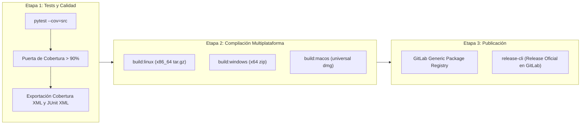

# Pipeline CI/CD y Ciclo de Publicaciones

Gossip cuenta con una infraestructura automatizada de testing continuo, control estricto de cobertura y empaquetado multiplataforma.

---

## Arquitectura de la Pipeline

---

## Modelo de Ramas: `dev -> pre -> release`

1. **`dev` (Integración Continua)**:
   - Se integran las ramas de desarrollo y Merge Requests.
   - Pasan todos los tests unitarios y se exige el cumplimiento de la cobertura mínima del 90%.
2. **`pre` (Staging / Release Candidate)**:
   - Rama de congelación de código para estabilización y pruebas de regresión.
   - Dispara la compilación preliminar de ejecutables en todas las plataformas soportadas.
3. **`release` / `main` (Tags de Producción)**:
   - Al etiquetar con versión SemVer (`vX.Y.Z`), compila los binarios finales, los sube al registro de paquetes y genera la release oficial en GitLab.
