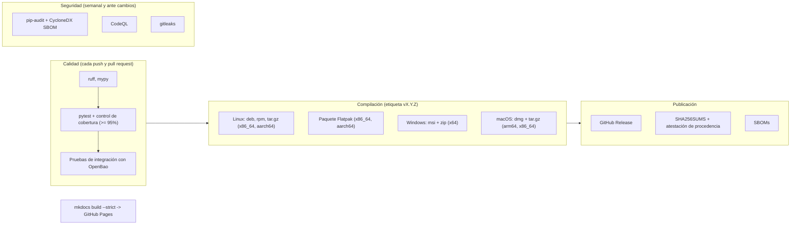

# Pipeline CI/CD y Ciclo de Publicaciones

Gossip ejecuta en GitHub Actions comprobaciones de calidad, análisis de seguridad y empaquetado multiplataforma. Cada versión etiquetada se compila para Linux (paquetes y Flatpak), Windows y macOS, y se publica con checksums y una atestación de procedencia.

---

## Arquitectura de la Pipeline



| Workflow | Archivo | Se ejecuta en | Hace |
|---|---|---|---|
| CI & Code Quality | `ci.yml` | push a `main`, `dev`, `pre`, `release`; pull requests a `main`, `dev` | ruff, mypy, tests con el control de cobertura del 95%, pruebas de integración con OpenBao |
| Auditoría de dependencias | `audit.yml` | cambios en los ficheros de bloqueo, cada semana | `pip-audit`, SBOM CycloneDX |
| Análisis de código | `codeql.yml` | push a `main`, pull requests, cada semana | CodeQL y gitleaks |
| Build & Release | `release.yml` | etiquetas `v*`, push a `pre` y `release`, manual | Paquetes nativos y Flatpak; publica la GitHub Release solo con etiquetas |
| Documentación | `pages.yml` | push a `main` y `release` | `mkdocs build --strict`, despliega en GitHub Pages |
| Actualización de dependencias | `update-build-deps.yml` | cada semana | Recalcula los ficheros de bloqueo y las fuentes de Flatpak, abre un pull request |

### Comprobación de tipos y pruebas de propiedades

`devenv test` ejecuta `mypy` sobre `src/` antes de la batería de pruebas, y la batería incluye pruebas de contrato de los proveedores (los mismos escenarios contra un sustituto en memoria de cada backend) y pruebas de propiedades con Hypothesis para los convertidores, el importador, la búsqueda, el diff y el archivo de estado.

### Análisis de código

`.github/workflows/codeql.yml` ejecuta CodeQL (Python, consultas `security-extended`) y un análisis con gitleaks de todo el historial en cada push, pull request y cada semana. Los hallazgos aparecen en *Security → Code scanning*.

### Auditoría de dependencias y SBOM

`.github/workflows/audit.yml` ejecuta `pip-audit` contra los tres ficheros de bloqueo con hash en cada cambio de ellos y cada semana, y genera los SBOM CycloneDX que adjuntan las publicaciones. Las herramientas de auditoría se instalan desde su propio fichero de bloqueo con hash (`requirements-audit.txt`).

### Pruebas de integración con Vault / OpenBao

El trabajo de CI descarga una versión fija de OpenBao (con el checksum verificado), la arranca en modo desarrollo desechable en `127.0.0.1:8200` con un token aleatorio y exporta `GOSSIP_TEST_VAULT_ADDR` / `GOSSIP_TEST_VAULT_TOKEN`. `tests/test_vault_integration.py` ejecuta entonces el `VaultClient` real contra él: rutas anidadas, creación con check-and-set, deshabilitar / habilitar / destruir versiones, borrado y una ida y vuelta de exportar → importar. `GOSSIP_REQUIRE_VAULT_TESTS=1` hace que el trabajo falle si esas variables desaparecen, en lugar de omitir las pruebas en silencio. En local las pruebas se omiten salvo que arranques `bao server -dev` y definas las variables (consulta el docstring de la prueba).

---

## Cómo se publica una versión

1. El trabajo llega a `main` (directamente o mediante un pull request) y el workflow de calidad debe estar en verde.
2. Si el cambio afecta a la compilación, ejecuta a mano el workflow *Build & Release* (`gh workflow run release.yml --ref main`): construye todos los paquetes pero no publica nada.
3. Etiqueta el commit con SemVer (`git tag vX.Y.Z && git push origin vX.Y.Z`). La etiqueta fija la versión en el código, compila todas las plataformas y publica la release con sus checksums, atestación y SBOM.
4. Las ramas `dev` y `pre` siguen disponibles para preparación; `pre` y `release` también ejecutan la compilación completa sin publicar.

---

---

## Artefactos de la release

Cada tag `vX.Y.Z` genera un paquete nativo por plataforma y arquitectura. Un paquete solo funciona en la arquitectura para la que se compiló, por lo que no hay un bundle "universal".

| Plataforma | Artefactos | Runner |
|---|---|---|
| Linux | `.deb`, `.rpm`, `.tar.gz` para `x86_64` y `aarch64` | Ubuntu (amd64 y arm64) |
| Linux (Flatpak) | paquete `.flatpak` para `x86_64` y `aarch64` | Ubuntu (amd64 y arm64) |
| Windows | instalador `.msi` y portable `.zip`, `x64` | `windows-latest` (MSYS2 UCRT64) |
| macOS | `.dmg` y `.tar.gz` para `arm64` y `x86_64` | `macos-latest` (arm64), `macos-15-intel` (x86_64) |

- **Icono de la aplicación**: los iconos de Windows (`.ico`) y macOS (`.icns`) se generan durante el build a partir del SVG de Linux con `scripts/generate_icons.sh`, de modo que todas las plataformas muestran el mismo icono. En macOS, además, se escribe la versión del paquete en `Info.plist` (macOS renueva un icono cacheado cuando cambia la versión) y la aplicación fija su propio icono del Dock al arrancar.
- **MSI de Windows**: se construye con [WiX](https://wixtoolset.org) a partir de `packaging/windows/gossip.wxs`, empaquetando la salida de PyInstaller.
- **Empaquetado en macOS**: `scripts/bundle_macos.py` copia el stack de GTK4 y el OpenSSL de Homebrew dentro de `gossip.app` y reescribe los install names a `@rpath`. El build verifica la arquitectura del binario y que la `libssl` incluida exporte los símbolos que necesita `cryptography`.
- **Firma**: los paquetes de Windows y macOS no están firmados ni notarizados.
- **Flatpak**: `packaging/flatpak/com.github.sincorchetes.gossip_gcp.yml` compila contra el runtime GNOME 51. Las dependencias de Python se instalan sin red desde las ruedas con hash de `python3-deps.json`, que `scripts/generate_flatpak_sources.py` deriva de `requirements-build.txt` (el workflow semanal de dependencias lo regenera). El job de CI ejecuta `--self-test` dentro del sandbox antes de empaquetar.

## Integridad de la cadena de suministro

- **Entradas de build fijadas**: los builds de release en Linux y macOS instalan desde `requirements-build.txt`, generado a partir de `requirements-build.in` con `uv pip compile --universal --generate-hashes` e instalado con `--require-hashes`. En Windows, MSYS2 aporta los paquetes nativos mediante `pacman` (que verifica sus propias firmas) y `requirements-windows.txt` fija con hashes el resto de paquetes Python puro; `scripts/pip_lock_subset.py` omite lo que `pacman` ya instaló.
- **Actions fijadas**: cada GitHub Action se referencia por SHA de commit; Dependabot propone actualizaciones semanalmente.
- **Checksums y procedencia**: cada release publica `SHA256SUMS.txt` y una atestación de procedencia del build firmada.
- **Inventario del paquete de Windows**: la release incluye `gossip-windows-x64-<tag>-packages.txt`, con la lista de paquetes de MSYS2 (pacman) y de pip incluidos en el build de Windows, cubierta por los checksums y la atestación. Los paquetes de MSYS2 no se pueden fijar por hash, así que este fichero es el rastro de auditoría.
- **Guardia de fecha límite**: los paquetes de Google Cloud exigirán `grpcio >= 1.83` desde abril de 2027; `scripts/check_grpcio_floor.py` calla hasta enero de 2027, avisa hasta la fecha límite y después hace fallar el build de Windows si MSYS2 no ha actualizado.

```bash
sha256sum -c SHA256SUMS.txt --ignore-missing
gh attestation verify gossip-linux-x86_64-vX.Y.Z.tar.gz --repo sincorchetes/gossip
```

Para actualizar dependencias, edita `requirements-build.in` y vuelve a ejecutar:

```bash
uv pip compile requirements-build.in --universal --python-version 3.14 --generate-hashes -o requirements-build.txt
```

Un workflow semanal (`update-build-deps.yml`) vuelve a resolver `requirements.txt` (entorno de desarrollo) y `requirements-build.txt` (builds de release) y abre una pull request con los cambios. Para que funcione hay que activar *Settings → Actions → General → Allow GitHub Actions to create and approve pull requests*. Como las pull requests creadas así no lanzan otros workflows, la validación real es el siguiente build de release con tag.
