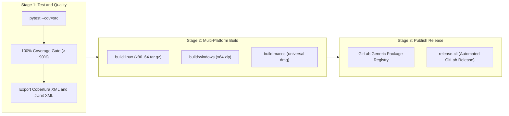

# CI/CD Pipeline & Release Workflow

Gossip integrates automated continuous testing, coverage enforcement, and multi-platform distribution.

---

## Pipeline Architecture

---

## Branching Model: `dev -> pre -> release`

1. **`dev` (Continuous Integration)**:
   - Feature branches merge into `dev`.
   - Runs unit tests and verifies code coverage with a strict 90% threshold.
2. **`pre` (Staging / Release Candidate)**:
   - Code freeze branch for stabilization and integration testing.
   - Triggers preliminary packaging builds across all target operating systems.
3. **`release` / `main` (Production Tags)**:
   - Tagging a commit with SemVer (`vX.Y.Z`) triggers production compilation, uploads binaries to the package registry, and generates the official Release.
