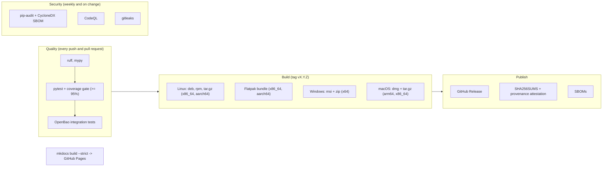

# CI/CD Pipeline & Release Workflow

Gossip runs automated quality checks, security scans and multi-platform packaging on GitHub Actions. Each tagged version is built for Linux (packages and Flatpak), Windows and macOS, and published with checksums and a provenance attestation.

---

## Pipeline Architecture



| Workflow | File | Runs on | Does |
|---|---|---|---|
| CI & Code Quality | `ci.yml` | push to `main`, `dev`, `pre`, `release`; pull requests to `main`, `dev` | ruff, mypy, tests with the 95% coverage gate, OpenBao integration tests |
| Dependency audit | `audit.yml` | changes to the lock files, weekly | `pip-audit`, CycloneDX SBOM |
| Code scanning | `codeql.yml` | push to `main`, pull requests, weekly | CodeQL and gitleaks |
| Build & Release | `release.yml` | tags `v*`, pushes to `pre` and `release`, manual | Native packages, Flatpak; publishes the GitHub Release on tags only |
| Documentation | `pages.yml` | push to `main` and `release` | `mkdocs build --strict`, deploys to GitHub Pages |
| Dependency refresh | `update-build-deps.yml` | weekly | Re-resolves the lock files and the Flatpak sources, opens a pull request |

### Type checking and property tests

`devenv test` runs `mypy` over `src/` before the test suite, and the suite includes provider contract tests (the same scenarios against an in-memory stand-in of every backend) and Hypothesis property tests for the converters, importer, search, diff and state file.

### Code scanning

`.github/workflows/codeql.yml` runs CodeQL (Python, `security-extended` queries) and a gitleaks scan of the whole history on every push, pull request and week. Findings appear under *Security → Code scanning*.

### Dependency audit and SBOM

`.github/workflows/audit.yml` runs `pip-audit` against the three hashed locks on every change to them and every week, and builds the CycloneDX SBOMs that releases attach. The audit tools are installed from their own hashed lock (`requirements-audit.txt`).

### Vault / OpenBao integration tests

The CI job downloads a pinned OpenBao release (checksum verified), starts it in throwaway dev mode on `127.0.0.1:8200` with a random token, and exports `GOSSIP_TEST_VAULT_ADDR` / `GOSSIP_TEST_VAULT_TOKEN`. `tests/test_vault_integration.py` then drives the real `VaultClient` against it: nested paths, check-and-set creation, version disable / enable / destroy, deletion and an export → import round trip. `GOSSIP_REQUIRE_VAULT_TESTS=1` makes the job fail if those variables go missing instead of silently skipping. Locally the tests are skipped unless you start `bao server -dev` yourself and set the variables (see the test's docstring).

---

## Releasing

1. Work lands on `main` (or arrives through a pull request) and the quality workflow must be green.
2. For a change to the build itself, run the *Build & Release* workflow by hand (`gh workflow run release.yml --ref main`): it builds every package but publishes nothing.
3. Tag the commit with SemVer (`git tag vX.Y.Z && git push origin vX.Y.Z`). The tag stamps the version into the sources, builds all platforms and publishes the release with its checksums, attestation and SBOMs.
4. The `dev` and `pre` branches remain available for staging; `pre` and `release` also run the full build without publishing.

---

---

## Release Artifacts

Each `vX.Y.Z` tag builds one native package per platform and architecture. A package only runs on the architecture it was built for, so there is no "universal" bundle.

| Platform | Artifacts | Runner |
|---|---|---|
| Linux | `.deb`, `.rpm`, `.tar.gz` for `x86_64` and `aarch64` | Ubuntu (amd64 and arm64) |
| Linux (Flatpak) | `.flatpak` bundle for `x86_64` and `aarch64` | Ubuntu (amd64 and arm64) |
| Windows | `.msi` installer and `.zip` portable, `x64` | `windows-latest` (MSYS2 UCRT64) |
| macOS | `.dmg` and `.tar.gz` for `arm64` and `x86_64` | `macos-latest` (arm64), `macos-15-intel` (x86_64) |

- **Application icon**: Windows (`.ico`) and macOS (`.icns`) icons are generated at build time from the Linux SVG by `scripts/generate_icons.sh`, so all platforms show the same icon. On macOS the bundle version is also stamped into `Info.plist` (macOS refreshes a cached icon when the version changes) and the app sets its own Dock icon at startup.
- **Windows MSI**: built with [WiX](https://wixtoolset.org) from `packaging/windows/gossip.wxs`, wrapping the PyInstaller output.
- **macOS bundling**: `scripts/bundle_macos.py` copies the GTK4 stack and Homebrew's OpenSSL into `gossip.app` and rewrites install names to `@rpath`. The build verifies the binary architecture and that the bundled `libssl` exports the symbols `cryptography` needs.
- **Signing**: Windows and macOS packages are not code-signed or notarized.
- **Flatpak**: `packaging/flatpak/com.github.sincorchetes.gossip_gcp.yml` builds against the GNOME 51 runtime. Python dependencies are installed offline from the hashed wheels listed in `python3-deps.json`, which `scripts/generate_flatpak_sources.py` derives from `requirements-build.txt` (the weekly dependency workflow regenerates it). The CI job runs `--self-test` inside the sandbox before bundling.

## Supply-chain integrity

- **Pinned build inputs**: release builds on Linux and macOS install from `requirements-build.txt`, generated from `requirements-build.in` with `uv pip compile --universal --generate-hashes` and installed with `--require-hashes`. On Windows, MSYS2 supplies the native packages through `pacman` (which verifies its own signatures) and `requirements-windows.txt` pins the remaining pure-Python packages with hashes; `scripts/pip_lock_subset.py` skips whatever `pacman` already installed.
- **Pinned actions**: every GitHub Action is referenced by commit SHA; Dependabot proposes updates weekly.
- **Checksums and provenance**: each release publishes `SHA256SUMS.txt` and a signed build-provenance attestation.
- **Windows package inventory**: the release includes `gossip-windows-x64-<tag>-packages.txt`, the list of MSYS2 (pacman) and pip packages bundled in the Windows build, covered by the checksums and the attestation. MSYS2 packages cannot be pinned by hash, so this file is the audit trail.
- **Deadline guard**: Google Cloud packages will require `grpcio >= 1.83` from April 2027; `scripts/check_grpcio_floor.py` stays silent until January 2027, warns until the deadline and then fails the Windows build if MSYS2 has not updated.

```bash
sha256sum -c SHA256SUMS.txt --ignore-missing
gh attestation verify gossip-linux-x86_64-vX.Y.Z.tar.gz --repo sincorchetes/gossip
```

To update dependencies, edit `requirements-build.in` and re-run:

```bash
uv pip compile requirements-build.in --universal --python-version 3.14 --generate-hashes -o requirements-build.txt
```

A weekly workflow (`update-build-deps.yml`) re-resolves `requirements.txt` (development environment) and `requirements-build.txt` (release builds) and opens a pull request with the changes. Enable *Settings → Actions → General → Allow GitHub Actions to create and approve pull requests* for it to work. Because pull requests created this way do not trigger other workflows, the real validation is the next tagged release build.
